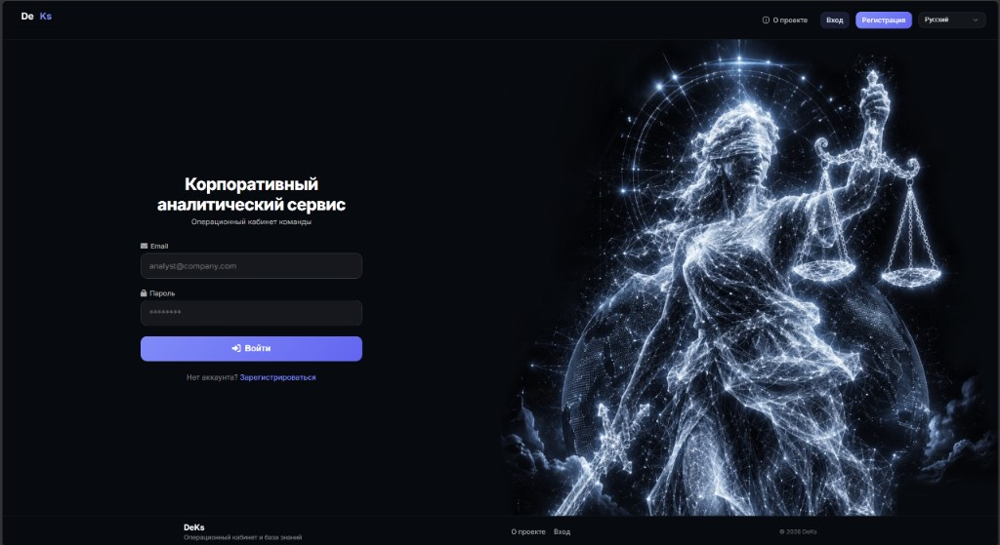
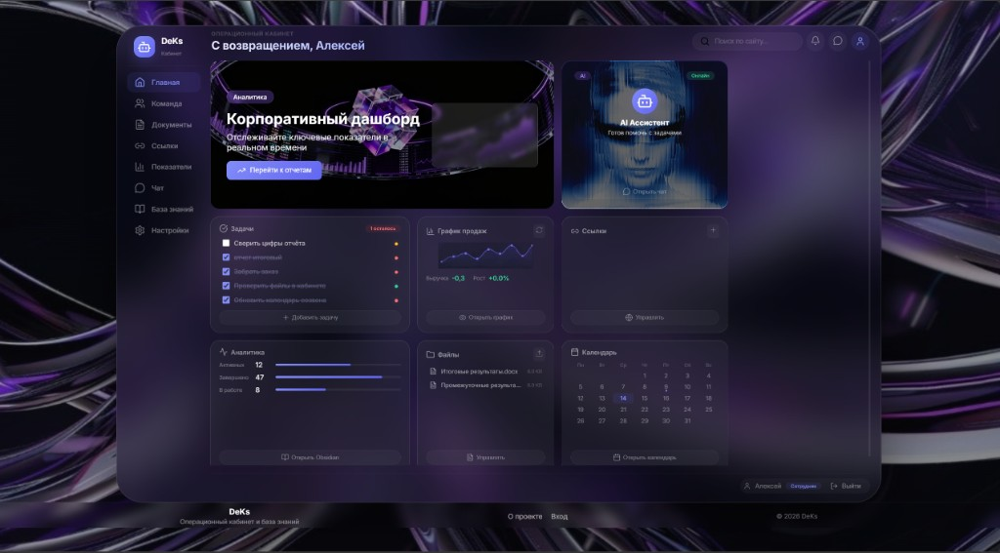
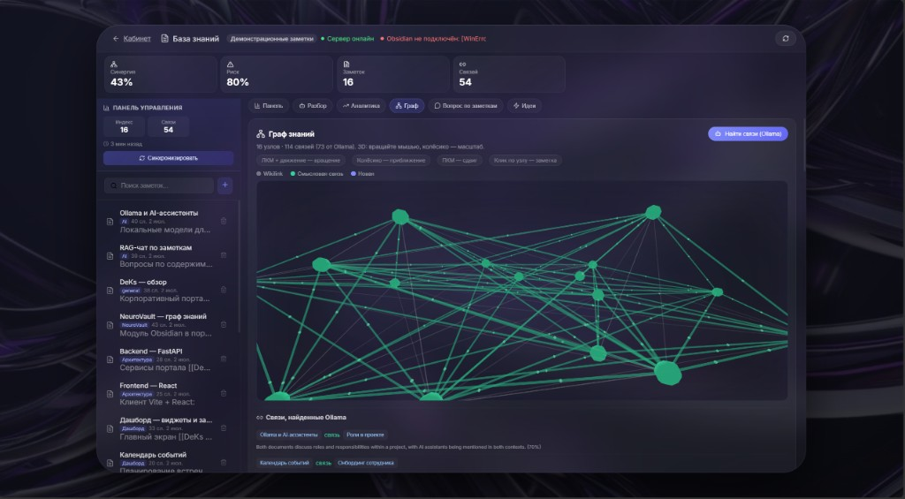

# DeKs

[](https://github.com/Ronin-proger/DeKs/actions/workflows/ci.yml)

Team workspace built around a shared Obsidian vault: tasks, calendar, files and messenger on one side, a searchable knowledge graph with a local language model on the other. Notes stay plain markdown in the vault; the service indexes them, links them and answers questions with sources.

React · FastAPI · SQLite · Ollama · Docker Compose




## Capabilities

- **Workspace.** Tasks, calendar, files, shared links, metrics, page parsing (headings, links, tables) and full-text search across the workspace.
- **Messenger.** Shared and direct rooms, attachments, unread counters.
- **Vault sync.** Two-way exchange with Obsidian through the Local REST API, with a direct file-system fallback. Webhooks queue re-indexing when a note changes. Front matter, folders, tags and `[[wikilinks]]` are parsed into SQLite, so analytics never hit Obsidian on a page load.
- **Retrieval.** Notes are embedded with a local model; questions are answered only from the nearest fragments and always return their sources. With no relevant context the assistant says so.
- **Link discovery.** Pairs of semantically close notes that are not linked yet are proposed with a one-line reason; accepted links show up on the graph.
- **Vault report.** A structured review of the whole vault: topics and clusters, isolated notes and duplicates, suggested links, next steps. Reports are stored and can be reopened without recomputation.
- **Graph and metrics.** 3D graph with explicit and inferred links, semantic landscape, link density, hub notes, weekly activity.



## Architecture

```text
React / Vite ──► FastAPI ─┬─ workspace · messenger · profile · parser
                          ├─ SQLite (users, sessions, workspace, note index)
                          ├─ Obsidian Local REST API ↔ markdown vault
                          └─ /api/intelligence
                               ├─ vault_sync      note index, wikilinks, webhook queue
                               ├─ embeddings      Ollama embed model
                               ├─ rag             retrieval + answer with sources
                               ├─ link_discovery  candidate pairs → model verdict
                               ├─ metrics         graph, landscape, insights
                               └─ vault_agent     stored vault report
```

The intelligence layer is a separate router and never mixes with CRUD handlers. Embeddings are required: when the embed model is unreachable, retrieval endpoints return `503` instead of degrading silently. A token-hash index can be enabled explicitly for offline development (`EMBEDDING_FALLBACK=hash`); responses then carry `embeddingBackend: "hash"`.

## Security

- Session tokens in an httpOnly cookie (`Secure` behind HTTPS via `COOKIE_SECURE`); every route except `/health`, `/api/login` and `/api/register` requires a session.
- Passwords are stored as bcrypt hashes. Legacy plaintext rows are converted once by `scripts/migrate_passwords_to_bcrypt.py`.
- The vault webhook is verified by `WEBHOOK_SECRET` (`X-Webhook-Secret` or HMAC `X-Hub-Signature-256`).
- CORS origins are explicit (`CLIENT_ORIGIN`).

## Run

Requirements: Docker Compose, or Python 3.11+ and Node 20+; [Ollama](https://ollama.com) with a chat and an embed model (defaults `qwen2.5:1.5b`, `nomic-embed-text`); Obsidian with the Local REST API plugin.

```bash
cp .env.example .env
docker compose up -d --build
```

UI `http://localhost:5173`, API `http://localhost:3001`.

Without Docker:

```bash
make api      # uvicorn on :3001
make client   # Vite on :5173
make test
```

`HAC/` is a sample vault for local runs.

## Configuration

| Variable | Purpose |
| --- | --- |
| `CLIENT_ORIGIN` | Comma-separated browser origins allowed by CORS |
| `COOKIE_SECURE` | `true` behind HTTPS |
| `WEBHOOK_SECRET` | Shared secret for vault change webhooks |
| `OBSIDIAN_API_URL`, `OBSIDIAN_API_KEY`, `OBSIDIAN_VAULT_PATH` | Vault connectivity |
| `OLLAMA_BASE_URL`, `OLLAMA_CHAT_MODEL`, `OLLAMA_EMBED_MODEL` | Local models |
| `EMBEDDING_FALLBACK` | Empty by default; `hash` enables the offline token-hash index |
